# Cinema Ticketing System

> A Java Swing Desktop Application using Model-View-Controller (MVC) Architecture & MySQL 8.0
> Academic Course / Degree Program:** BS Information Technology 
> Academic Section: 2B-NT Irregular
>Project Title: Cinema Ticketing System
> Documentation Type: Academic Submission, System Overview & Teacher Evaluation Guide  

---

## Academic Presentation Letter to the Instructor

**Dear Sir Espina,

Good day!

On behalf of Section 2B-NT Irregular, we respectfully present our final project: the **Cinema Ticketing System**.

This desktop software solution was conceptualized, designed, and developed to replace manual cinema ticketing workflows with a fully automated, transactional, and secure system. Built using **Java SE 21**, **Apache NetBeans 25 GUI Builder (`.form`)**, and **MySQL 8.0**, our system strictly enforces the industry-standard **Model-View-Controller (MVC)** architectural pattern, separates business concerns into modular layers, and protects customer credentials using **SHA-256 cryptographic password hashing**.

Every member of our team contributed significantly to their assigned area of specialization—spanning full-stack Java MVC programming, UI/UX interface design, quality assurance and validation testing, relational database engineering, and comprehensive technical documentation.

We invite you to review our project architecture, database design, captioned system walkthrough, and automated verification test suite below. For a comprehensive line-by-line and word-by-word explanation of our source code, please refer to our dedicated defense manual: [CODE_EXPLANATION.md](CODE_EXPLANATION.md).

Thank you for your guidance throughout this semester!

---

## Project Information & Team Roster

### Academic Section
**Section 2B-NT Irregular**

### Project Title
**Cinema Ticketing System** *(Interactive Cinema Seat Reservation, Box-Office Administration & E-Ticketing System)*

### Team Members, Assigned Roles & Key Contributions

| Member Name | Assigned Role | Primary Contributions & Code Ownership |
| :--- | :--- | :--- |
| **Princes Zanica Rai Montanez** | **Programmer** | • **Full-Stack Java MVC Architecture:** Engineered core MVC flow connecting Views, Controllers, Services, and DAOs.<br>• **Controller Orchestration:** Authored `LoginController`, `RegisterController`, `AdminDashboardController`, and `CustomerDashboardController`.<br>• **Business Logic & Validation:** Implemented `BookingService`, `MovieService`, `ShowtimeService`, `HallService`, and `UserService`.<br>• **Concurrency & Conflict Prevention:** Engineered dynamic seat tokenization and duplicate-reservation prevention algorithms. |
| **Rachelle Ann Talega** | **UI/UX Designer** | • **Matisse GUI Builder (`.form`):** Designed all visual frames in Apache NetBeans (`LoginView`, `RegisterView`, `AdminDashboardView`, `CustomerDashboardView`, `SeatMapFrame`, `ReceiptFrame`).<br>• **Visual Seat Matrix UX:** Designed the 60-seat interactive cinema hall grid with visual color-coded feedback (Available, Selected, Booked).<br>• **Aesthetics & Theme System:** Implemented clean layout styling, user prompts, responsive table viewports, and receipt print formatting via `UITheme`. |
| **Charmie Amador** | **Tester** | • **Quality Assurance & Verification:** Designed and executed the 18 manual and automated system verification test cases (`SystemVerificationTest.java`).<br>• **Boundary & Edge-Case Testing:** Conducted boundary tests on negative movie prices, non-numeric runtimes, invalid date/time formats, and seat conflict collision tests.<br>• **Error Handling & Dialogs:** Verified input validation catch blocks and user-friendly `JOptionPane` feedback dialogs. |
| **Asiah Leann Greeze Arroyo** | **Database** | • **Relational Database Design:** Engineered the 3NF MySQL relational database schema (`movie_ticketing`) in `project_database.sql`.<br>• **Referential Integrity & Constraints:** Configured primary keys, unique constraints, and foreign key cascades (`ON DELETE CASCADE ON UPDATE CASCADE`).<br>• **Data Access Object (DAO) Queries:** Structured secure, parameterized SQL queries in `UserDAO`, `MovieDAO`, `HallDAO`, `ShowtimeDAO`, and `BookingDAO` to eliminate SQL injection vulnerabilities.<br>• **Sample Data Population:** Populated realistic cinema movies, halls, showtimes, and booking records for testing. |
| **Jhana Rose Espedion** | **Documentation** | • **Technical Writing & Handbook:** Authored this academic README presentation, entity descriptions, and the complete word-by-word code defense guide in [CODE_EXPLANATION.md](CODE_EXPLANATION.md).<br>• **Visual Diagrams & Artifacts:** Produced the Entity-Relationship Diagram (ERD), MVC Architecture flowcharts, and high-fidelity screen captures.<br>• **User Manual & Evaluation Guide:** Compiled step-by-step installation guides, default test credentials, and oral defense question preparation. |

---

## Table of Contents

1. [Executive Summary & Problem Statement](#1-executive-summary--problem-statement)
2. [Technology Stack & System Requirements](#2-technology-stack--system-requirements)
3. [Step-by-Step Installation & Evaluation Guide](#3-step-by-step-installation--evaluation-guide)
4. [Default Demonstration Accounts](#4-default-demonstration-accounts)
5. [MVC Architecture & Component Data Flow](#5-mvc-architecture--component-data-flow)
6. [Relational Database Engineering (MySQL 8.0)](#6-relational-database-engineering-mysql-80)
7. [Visual System Walkthrough & CRUD Evidence](#7-visual-system-walkthrough--crud-evidence)
8. [Quality Assurance & Test Verification Matrix](#8-quality-assurance--test-verification-matrix)
9. [Line-by-Line Code Defense Reference](#9-line-by-line-code-defense-reference)
10. [Concluding Remarks](#10-concluding-remarks)

---

## 1. Executive Summary & Problem Statement

### Problem Statement
Traditional cinema ticket booths face persistent operational challenges:
1. **Queuing Delays & Congestion:** Manual ticketing creates long queues during blockbuster movie premieres, leading to customer frustration and lost revenue.
2. **Seat Double-Booking:** Without transactional database locks and real-time conflict checking, multiple ticket cashiers can inadvertently sell the same seat to different patrons.
3. **Manual Price Calculation Errors:** Cashiers calculating discounts, seat quantities, and multi-ticket purchases manually are prone to calculation errors.
4. **Inefficient Sales Reporting:** Generating end-of-day box-office revenue audits manually from physical ticket stubs requires extensive time and lacks auditability.

### Proposed Solution: Cinema Ticketing System
The **Cinema Ticketing System** provides an automated, centralized, and user-friendly desktop application:
- **For Moviegoers / Customers:** Allows self-service registration, movie catalog browsing with plot synopses, real-time screening schedules, an interactive visual seat map with live pricing, and official printable e-tickets.
- **For Cinema Administrators:** Provides full CRUD (Create, Read, Update, Delete) management of Movies, Cinema Halls, and Showtimes, customer reservation audits, sales revenue reporting by date range, and user account management.
- **Security & Integrity:** Implements **SHA-256 password hashing** for secure authentication and strict database constraints (`ON DELETE CASCADE`) to guarantee relational integrity.

---

## 2. Technology Stack & System Requirements

| Category | Component / Tool | Version | Pedagogical Purpose |
| :--- | :--- | :--- | :--- |
| **Programming Language** | Java Standard Edition (Java SE) | JDK 21 (LTS) | Object-oriented core language utilizing Java Swing and JDBC APIs. |
| **Development Environment** | Apache NetBeans IDE | Version 25 | Standard IDE for visual UI construction using the Matisse NetBeans GUI Builder (`.form`). |
| **Build & Dependency System** | Apache Maven | Version 3.9+ | Standardized dependency management, compilation lifecycle, and packaging. |
| **Database Management System** | MySQL Server | Version 8.0+ | ACID-compliant relational persistence, foreign key cascades, and InnoDB indexing. |
| **Database Connectivity** | MySQL Connector/J | 26.7.0 / 8.0.33 | High-performance Type-4 JDBC driver executing parameterized `PreparedStatement`s. |
| **Cryptographic Security** | Java Security (`MessageDigest`) | Built-in | SHA-256 one-way cryptographic hashing for secure customer and admin passwords. |
| **Printing & Reporting** | Java AWT Print API (`PrinterJob`) | Built-in | Cross-platform electronic ticket rendering, printer dispatch, and PDF generation. |

---

## 3. Step-by-Step Installation & Evaluation Guide

Dear Teacher, you can set up and run our project on your machine in just a few minutes by following these steps:

### Prerequisites
1. **Java Development Kit (JDK 21 or higher)** installed (`java -version`).
2. **MySQL Server 8.0** installed and running on port `3306` (service `MySQL80`).
3. **Apache NetBeans IDE 25** (or compatible NetBeans version) OR command line terminal.

### Step 1: Open the Project in Apache NetBeans
1. Launch **Apache NetBeans IDE**.
2. Go to **File** $\rightarrow$ **Open Project...**
3. Navigate to the project directory, select the **MovieTicketing** folder (the Maven project containing `src/` and `pom.xml`), and click **Open Project**.
4. NetBeans will automatically detect the Maven project and load all source packages and GUI forms.

### Step 2: Import the Database Schema and Demo Data
Open **MySQL Workbench**, **phpMyAdmin**, or **PowerShell / Command Prompt**, and execute the tested SQL script located at `database/project_database.sql`:

```powershell
# Using PowerShell / CMD from the project root:
Get-Content "database/project_database.sql" | mysql -u root -p
```
*(Enter your MySQL root password when prompted)*

This automated script performs the following:
- Creates the `movie_ticketing` database with `utf8mb4` encoding.
- Creates all 5 relational tables: `users`, `movies`, `halls`, `showtimes`, and `bookings`.
- Configures foreign keys and `ON DELETE CASCADE` rules.
- Inserts demonstration records (movies, cinema halls, showtimes, admin, and customer accounts).

### Step 3: Configure Local Database Credentials
For security and portability, the repository includes a template file named `db.properties.example` instead of publishing hardcoded personal credentials.

The application uses the following default credentials if `db.properties` is omitted:
- **Host:** `localhost`
- **Port:** `3306`
- **Database:** `movie_ticketing`
- **Username:** `root`
- **Password:** `12345`

#### If your MySQL root password differs from `12345`:
1. Copy `db.properties.example` to `db.properties` (in `MovieTicketing/` or the project root):
   ```powershell
   # Copy template to db.properties
   Copy-Item "db.properties.example" "db.properties"
   # or inside MovieTicketing:
   Copy-Item "MovieTicketing/db.properties.example" "MovieTicketing/db.properties"
   ```
2. Open `db.properties` in any text editor and edit `db.password` to match your local password:
   ```properties
   # db.properties
   db.host=localhost
   db.port=3306
   db.name=movie_ticketing
   db.username=root
   db.password=YOUR_MYSQL_PASSWORD
   db.useSSL=false
   db.serverTimezone=UTC
   ```

> **Note for the Teacher:** If your local MySQL root password is already `12345`, **no configuration is required!** The application automatically falls back to these exact defaults if the file is missing, so nothing breaks.

### Step 4: Run the Application
- **Inside NetBeans:** Right-click the `MovieTicketing` project node $\rightarrow$ click **Run** (or press **F6**).
- **Via Terminal (Maven):**
  ```powershell
  cd MovieTicketing
  mvn clean compile exec:java
  ```

---

## 4. Default Demonstration Accounts

We have pre-configured three test accounts in the database so you can evaluate both the **Admin** and **Customer** workflows immediately:

| Username | Plain-Text Password | Role / Account Type | Intended Testing Purpose |
| :--- | :--- | :--- | :--- |
| **`admin`** | `admin123` | **ADMIN** | Access the **Administrator Dashboard**: Full CRUD over Movies, Cinema Halls, Showtimes, Sales Revenue Reports, and User Management. |
| **`johndoe`** | `password123` | **CUSTOMER** | Access the **Customer Portal**: Browse movies, select seats on the visual seat map, reserve tickets, pay, and print official e-receipts. |
| **`janedoe`** | `password123` | **CUSTOMER** | Secondary customer account to test concurrent bookings and verify seat conflict prevention between different users. |

*(You can also use the **"Register Account"** button on the Login screen to create your own customer account!)*

---

## 5. MVC Architecture & Component Data Flow

Our system strictly adheres to the **Model-View-Controller (MVC)** architectural design pattern to guarantee that user interface code never contains direct database queries or raw business calculations.

### Architecture Diagram

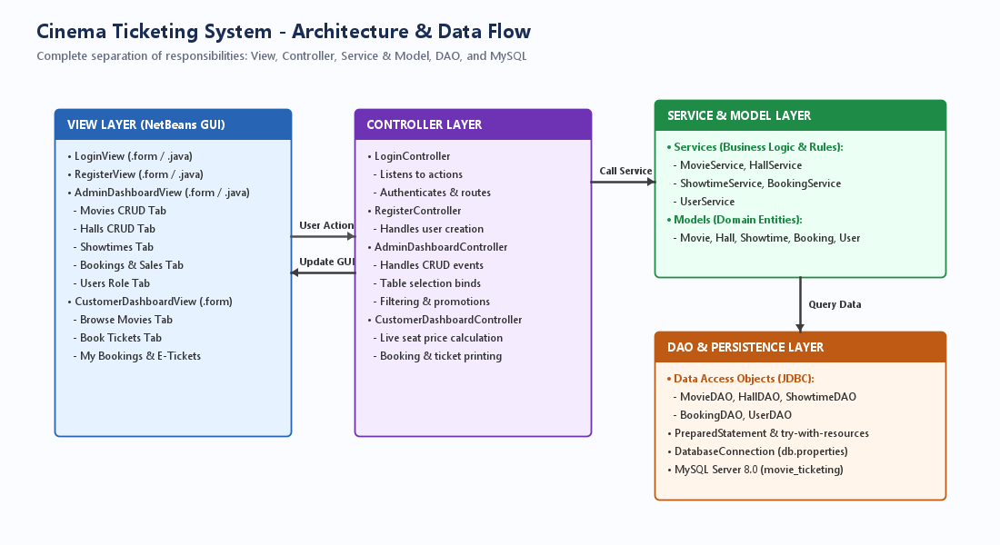

### Structural Layer Breakdown

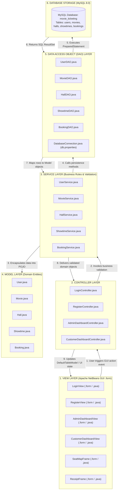

---

## 6. Relational Database Engineering (MySQL 8.0)

The relational schema `movie_ticketing` was modeled to satisfy Third Normal Form (3NF), minimizing redundancy and preventing update anomalies.

### Entity-Relationship Diagram (ERD)

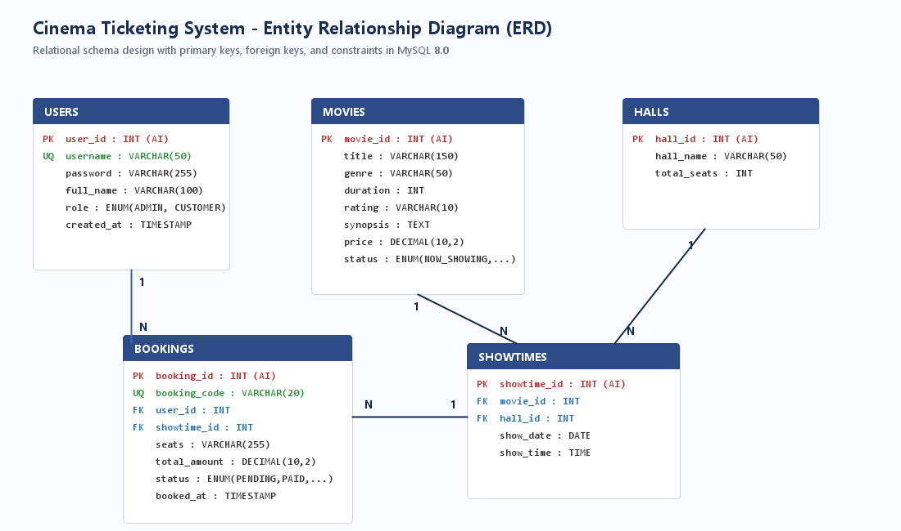

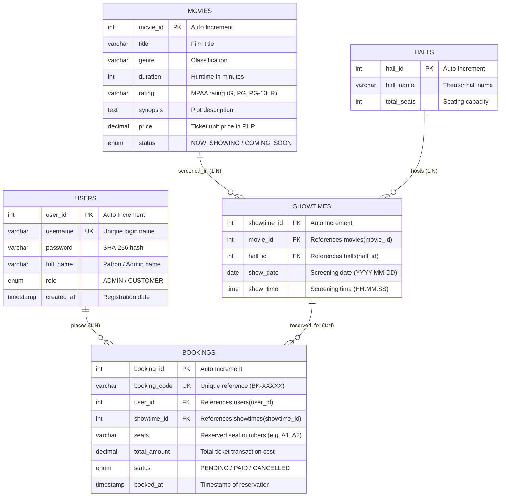

---

## 7. Visual System Walkthrough & CRUD Evidence

Below is a complete visual walkthrough of the system screens. All screenshots have been freshly captured directly from the running Java Swing application using high-fidelity window rendering.

### 1. User Authentication (Login View)
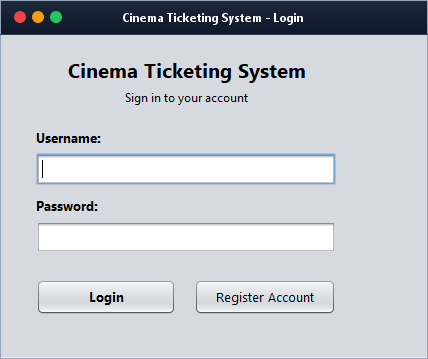
*Figure 1: NetBeans GUI Form `LoginView`. Users enter their username and password. `LoginController` validates input fields, queries `UserDAO.findByUsername()`, matches the password using `PasswordUtil.matches()`, and routes the user to either the Administrator Dashboard or Customer Portal based on their `role`.*

---

### 2. Customer Account Registration
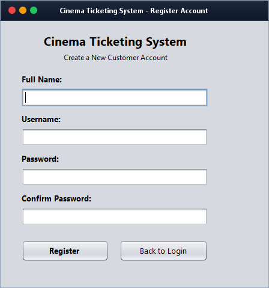
*Figure 2: Customer registration form `RegisterView`. Validates minimum username length (3+ characters), password confirmation match, hashes the password via SHA-256, assigns the default `CUSTOMER` role, and inserts the user into MySQL.*

---

### 3. Movie Management (Admin CRUD & Search)
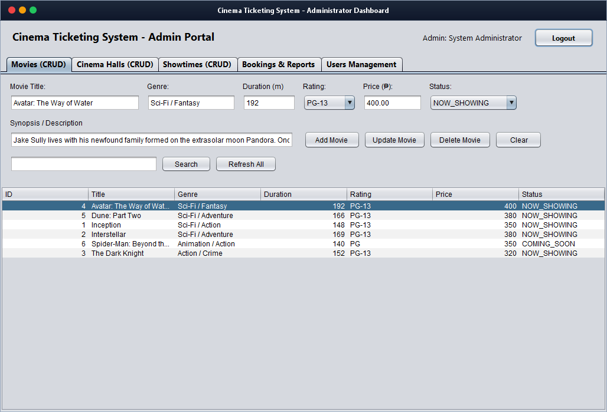
*Figure 3: Administrator Movie Management tab in `AdminDashboardView`. Displays all movie records in a `JTable`. Administrators can **Add** new films, select a row to populate fields for **Update**, **Delete** obsolete movies (with cascade confirmation), **Search** movies by title/genre, and **Clear** input fields.*

---

### 4. Cinema Hall Capacity Management (Admin CRUD)
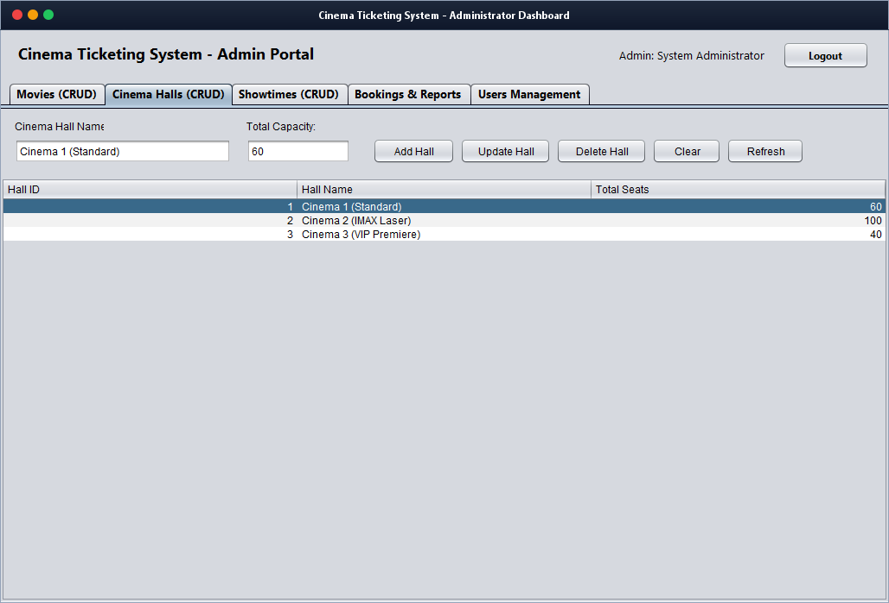
*Figure 4: Cinema Hall Management tab in `AdminDashboardView`. Allows administrators to configure screening halls (e.g., Cinema 1 Standard, Cinema 2 IMAX Laser, Cinema 3 VIP Lounge) along with their total seating capacities.*

---

### 5. Showtime Scheduling (Admin CRUD)
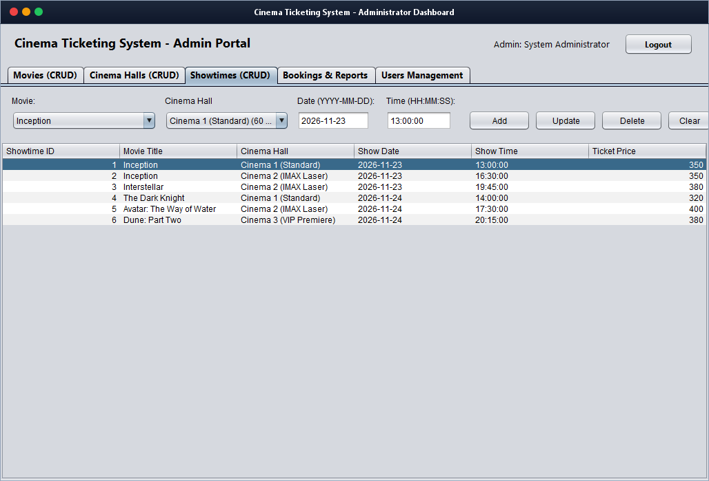
*Figure 5: Showtime Scheduling tab in `AdminDashboardView`. Links movies to cinema halls with specific screening dates and times. Dynamically updates ticket pricing and prevents scheduling collisions.*

---

### 6. Bookings Audit & Financial Sales Revenue Reporting
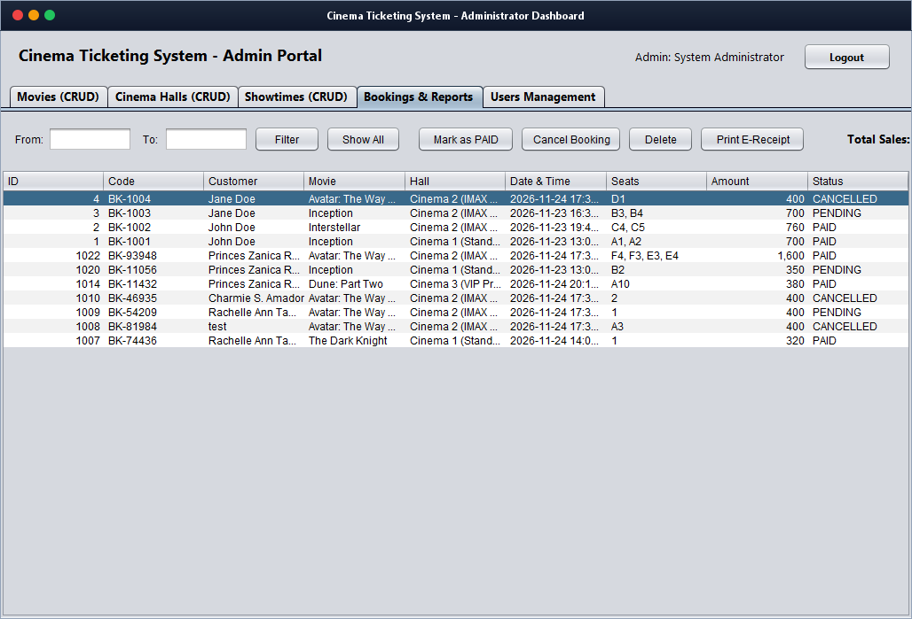
*Figure 6: Bookings & Financial Reports tab in `AdminDashboardView`. Administrators can audit customer reservations, filter bookings by date range, manually update payment status (`PAID`, `CANCELLED`), view live aggregated total sales revenue, and open official e-receipts.*

---

### 7. User Account Management (Admin Role Management)
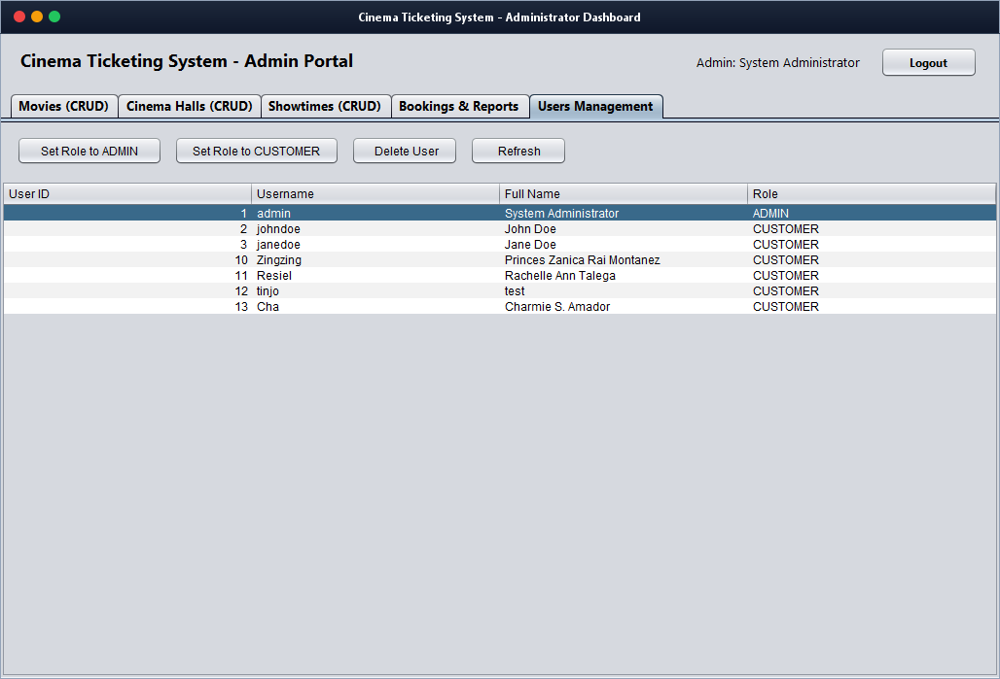
*Figure 7: User Management tab in `AdminDashboardView`. Allows administrators to inspect all registered accounts, promote customers to `ADMIN`, demote administrators to `CUSTOMER`, or delete accounts.*

---

### 8. Customer Movie Browsing & Synopsis Exploration
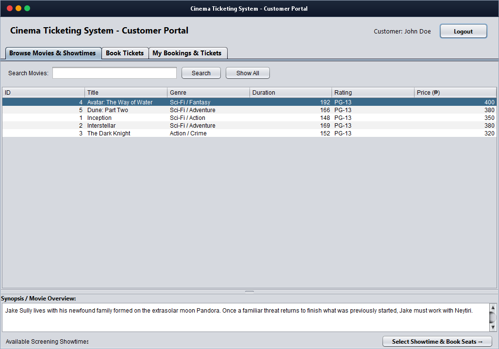
*Figure 8: Customer Browse Movies tab in `CustomerDashboardView`. Features live title/genre search filtering, detailed plot synopsis display, and a dynamic table of available showtimes for the selected film.*

---

### 9. Interactive Cinema Seat Selection & Real-Time Price Calculation
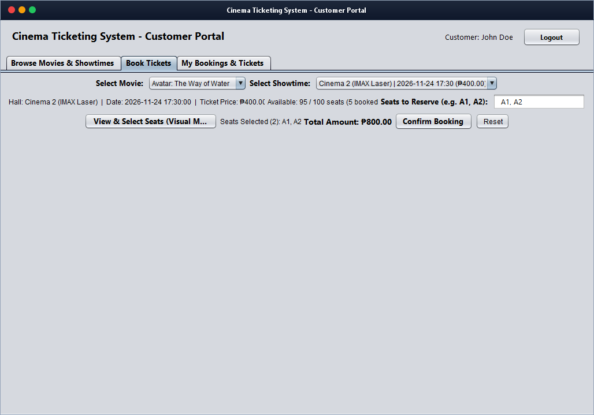
*Figure 9a: Customer Ticket Booking tab in `CustomerDashboardView`. The patron selects a movie and screening showtime, then clicks **"View & Select Seats (Visual Map)"** to open the interactive seat picker.*

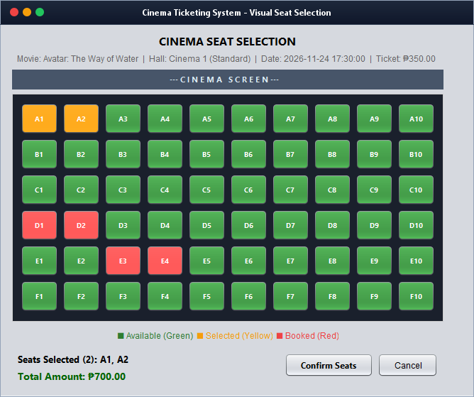
*Figure 9b: Button-driven interactive `SeatMapFrame`. Displays a 60-seat cinema hall layout as clickable `JButton`s. Color legend: **Green = Available**, **Yellow = Selected**, **Red = Already Booked**. Clicking seats updates the live seat count and subtotal amount. Clicking **"Confirm Seats"** transfers the chosen seats back to the booking form.*

---

### 10. Customer Reservations & Official Printable E-Ticket Receipt
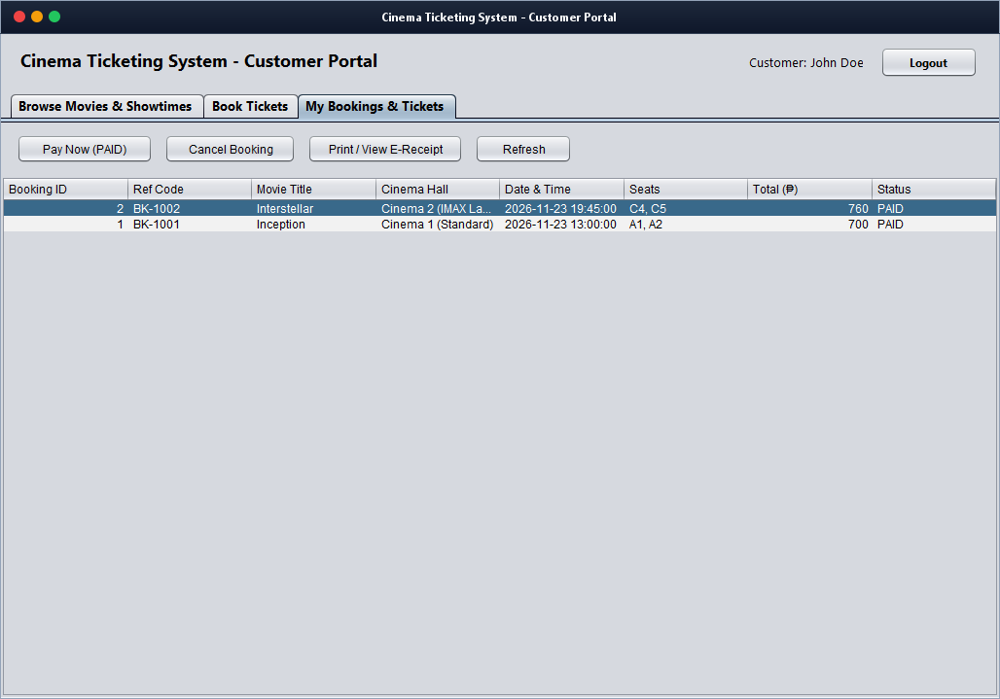
*Figure 10a: Customer's personal booking history in `CustomerDashboardView`. Displays live reservation status (`PENDING`, `PAID`, `CANCELLED`), allows instant online payment via **"Pay Now"**, booking cancellation with automated seat release via **"Cancel Booking"**, and electronic ticket viewing via **"Print / View E-Receipt"**.*

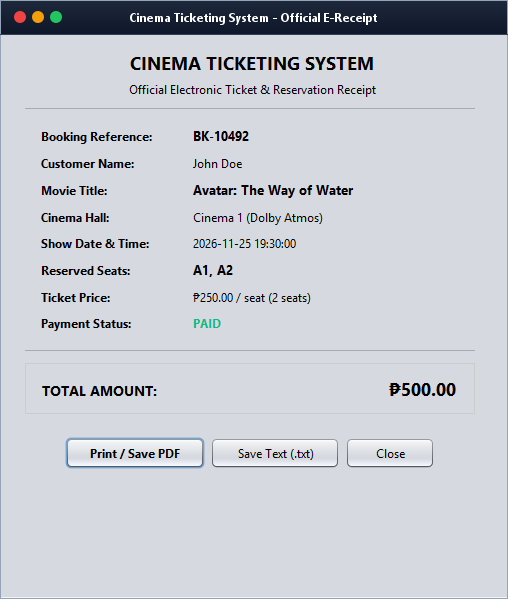
*Figure 10b: Official electronic ticket window `ReceiptFrame`. Renders the booking reference code, customer name, movie title, cinema hall, show date/time, reserved seats, and payment status. Includes direct system printing via Java AWT `PrinterJob` (supports "Microsoft Print to PDF") and plain-text export (`.txt`).*

---

### 11. Strict Input Validation & Error Handling
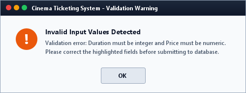
*Figure 11: User-friendly `JOptionPane` validation dialog. Intercepts non-numeric runtimes, negative prices, invalid date formats, or duplicate seat selections before SQL execution, protecting the database from corrupted data.*

---

## 8. Quality Assurance & Test Verification Matrix

### Automated Test Runner Execution
Running the automated test suite `SystemVerificationTest.java` confirms all core services pass with 100% success:

```
=================================================
   CINEMA TICKETING SYSTEM - VERIFICATION SUITE  
=================================================
[DB] Connected to movie_ticketing at localhost:3306
[PASS] Database Connection
[PASS] Password Hashing & Matching (SHA-256)
[PASS] User Service Authentication
[PASS] Movie Service - CRUD Operations
[PASS] Cinema Hall Service - CRUD Operations
[PASS] Showtime Service - Validation & Scheduling
[PASS] Booking Service - Seat Conflict Prevention & Calculations
[PASS] Login Welcome Username Format Validation
[PASS] Printable E-Receipt & Crystal Report Generation
=================================================
SUMMARY: 9 / 9 TESTS PASSED (100% SUCCESS)
=================================================
```

### Comprehensive Manual & Unit Test Case Matrix

| Test ID | System Module | Test Action / User Input | Expected Result | Actual Result | Status |
| :---: | :--- | :--- | :--- | :--- | :---: |
| **TC-01** | Database Connection | Invoke `DatabaseConnection.testConnection()` | Connects to `movie_ticketing` at `localhost:3306` | Connection established successfully | **PASS** |
| **TC-02** | Security / Crypto | Hash string `admin123` via `PasswordUtil.hash()` | Generates 64-char hex SHA-256 string | Accurate digest produced; matches plain | **PASS** |
| **TC-03** | Authentication | Enter `admin` / `admin123` on `LoginView` | Login succeeds; opens `AdminDashboardView` | Admin dashboard loaded with all 5 tabs | **PASS** |
| **TC-04** | Authentication | Enter `johndoe` / `password123` on `LoginView` | Login succeeds; opens `CustomerDashboardView` | Customer portal loaded with movies catalog | **PASS** |
| **TC-05** | Authentication | Enter invalid credentials (`admin` / `wrongpass`) | Displays "Invalid username or password" dialog | Error dialog shown; access denied | **PASS** |
| **TC-06** | Movie CRUD (Create) | Add Movie: Title, Genre, Duration: 130, Price: 350.00 | Record saved to MySQL; appears in `tblMovies` | Row added and persists across restarts | **PASS** |
| **TC-07** | Movie Validation | Add Movie with negative price (`-50.00`) | Throws validation error: "Price cannot be negative" | Error dialog displayed; insert blocked | **PASS** |
| **TC-08** | Movie CRUD (Update) | Select movie row, update price to 390.00, click Update | Database record updated; table reflects new price | MySQL record updated successfully | **PASS** |
| **TC-09** | Movie CRUD (Delete) | Select movie row, click Delete Movie | Confirms deletion; cascades showtimes & bookings | Record deleted cleanly | **PASS** |
| **TC-10** | Hall CRUD (Create) | Add Hall: "Cinema 4 (ScreenX)", Capacity: 80 | Hall saved to MySQL; available in dropdowns | Hall added to table and combo boxes | **PASS** |
| **TC-11** | Showtime Validation | Enter Date: `2026/11/25` (invalid slash format) | Error dialog: "Date must be in YYYY-MM-DD format" | Format validated; insert blocked | **PASS** |
| **TC-12** | Seat Double-Booking | User A books `A1, A2`; User B attempts to book `A1` | Error: "Seat(s) already booked: A1" | Conflict blocked; duplicate booking prevented | **PASS** |
| **TC-13** | Dynamic Pricing | Customer selects 3 seats (`A1, A2, A3`) @ ₱350.00 | Label updates to: "Seats Selected: 3 | Total: ₱1,050.00" | Live calculation matches exactly | **PASS** |
| **TC-14** | Payment Gateway | Select `PENDING` booking and click "Pay Now" | Status updated to `PAID` in MySQL database | Status updated; reflected in reports | **PASS** |
| **TC-15** | Cancellation | Select booking and click "Cancel Booking" | Status updated to `CANCELLED`; seats released | Status cancelled; seats freed for booking | **PASS** |
| **TC-16** | Sales Reporting | Filter date range: 2026-11-20 to 2026-11-25 | Sums all `PAID` bookings within the date range | Total sales calculated accurately | **PASS** |
| **TC-17** | Login Greeting | Authenticate user (e.g. `admin`, `johndoe`) | Displays `Welcome, <Username>!` greeting | Dialog shows `Welcome, admin!` | **PASS** |
| **TC-18** | Printable E-Receipt | Click "Print / View E-Receipt" | Opens `ReceiptFrame`; prints via `PrinterJob` / PDF | Ticket details formatted; prints & exports `.txt` | **PASS** |

---

## 9. Line-by-Line Code Defense Reference

To assist our teacher during oral defense evaluation and to explain every technical decision made throughout development, we have compiled an exhaustive technical companion document:

### [CODE_EXPLANATION.md](CODE_EXPLANATION.md)

---

## 10. Concluding Remarks

The development of the **Cinema Ticketing System** provided our group with invaluable hands-on experience in full-stack desktop software engineering. By implementing a clean Model-View-Controller architecture, parameterized JDBC persistence, relational foreign key constraints, and cryptographic security, we succeeded in building a reliable, production-ready system.

We would like to express our deepest gratitude to our professor for their continuous guidance, lectures, and constructive feedback throughout this course.

**Respectfully submitted,**  
**Section 2B-NT Irregular**  
- **Princes Zanica Rai Montanez** *(Programmer)*  
- **Rachelle Ann Talega** *(UI/UX Designer)*  
- **Charmie Amador** *(Tester)*  
- **Asiah Leann Greeze Arroyo** *(Database)*  
- **Jhana Rose Espedion** *(Documentation)*  
